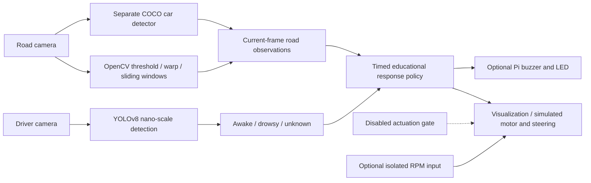

# Driver Monitoring and Model-Vehicle Safety Prototype

Fady Salib's computer-vision project (owner-reported period: **August 2024–June
2025**) combines a YOLOv8 awake/drowsy **object detector**, a road-camera lane
pipeline and nearby-car visualization with staged alert logic. Raspberry Pi
alert/RPM interfaces are optional. The legacy motor/steering policy is retained
for simulation, with **physical motor and steering commands disabled by default**.

**Educational prototype only. No real-vehicle safety validation exists. Do not
connect this application to a real vehicle.** Hardware-affecting changes require
separate review and testing on a safely isolated, unloaded model platform.

## Problem and scope

The software explores how perception observations feed timed alerts and an
experimental response policy. It demonstrates computer vision, model integration,
camera processing, state logic and simulated hardware tests. It does not establish
accident prevention, robust driver-state inference, or a validated autonomous
pull-over maneuver. Heart-rate monitoring, seat vibration, facial landmarks,
Eye Aspect Ratio and Mouth Aspect Ratio are **not implemented** in this repository.

## Architecture



The source preserves its existing lane/camera structure rather than introducing
a new control architecture. Perception interpretation is a separate function;
road processing now precedes decisions in the same iteration. GPIO setup is
explicit and never occurs when importing helpers. Main-loop cleanup runs in
`finally`, with independent best-effort shutdown actions.

## Implemented behavior and interlocks

- Model class IDs are read from `model.names`; drowsy takes priority when both
  states are detected. Confidence below 0.5, invalid values or no valid detection
  cannot imply awake. Unknown driver observations terminate with cleanup.
- Drowsiness starts the buzzer; after >3 seconds the LED turns on. The legacy
  simulation requests a model turn after another 2 seconds when lane/car checks
  permit, and motor-off after another 3 seconds. These are simulation behaviors,
  not instructions for real vehicle intervention.
- Current-frame lane/car results replace the old previous-frame steering check.
  Missing/degenerate lane fits inhibit the simulated turn. Processing older than
  a configurable one-second elapsed read/processing budget terminates; this does
  not measure camera-buffer age or interrupt a blocked call.
- Normal quit, read failure, inference exceptions, SIGTERM and startup failures
  use cleanup hooks. Motor-off is attempted before alert/PWM cleanup, even if
  another output fails. No software guarantee covers SIGKILL, OS hang or power loss.
- `ALLOW_MODEL_ACTUATION=False` prevents motor energizing and steering writes,
  even with `--enable-gpio`. There is no CLI switch to enable vehicle actuation.
  Tests override the gate only against fake pins. Keep it disabled pending a
  separately reviewed hardware calibration and safety design.

## Hardware and software

Two camera indices default to 0 (driver) and 1 (road). Tested software review
environment: Python 3.12, NumPy 2.2.6, OpenCV headless 4.12.0.88, Ultralytics
8.3.39, PyTorch 2.5.1+cpu and TorchVision 0.20.1+cpu. Desktop use needs the GUI
OpenCV package from `requirements.txt`. Notebook dependencies are separate.

| Optional interface (BCM) | Pin | Constraint |
|---|---:|---|
| Buzzer | 17 | Rated driver circuit; not a speaker powered directly from GPIO |
| LED | 27 | Suitable current limiting |
| Motor relay | 22 | Off by default; configurable polarity; physical actuation gated |
| Steering PWM | 18 | No commanded angle with default gate; actual servo calibration unknown |
| RPM input | 26 | Isolated/level-compatible input; industrial sensor supply/output must be verified |

The previous code comments suggested powering an Autonics PR18-8DN directly from
3.3/5 V. That unverified wiring advice was removed. Consult the exact industrial
sensor datasheet and use an appropriate interface; do not expose Pi GPIO to
industrial supply voltages. Model, relay and sensor electrical compatibility has
not been bench-tested. See [hardware review](driver-drowsiness-detection/docs/audit.md).

## Setup and usage

The repository contains a nested application directory. Start here:

```bash
git clone https://github.com/fady-salib/driver-drowsiness-detection.git
cd driver-drowsiness-detection/driver-drowsiness-detection
python -m venv .venv
source .venv/bin/activate
# Optional CPU wheel source, to avoid a CUDA installation:
pip install torch==2.5.1 torchvision==0.20.1 --index-url https://download.pytorch.org/whl/cpu
pip install -r requirements.txt
python src/driver_assist.py --driver-cam 0 --road-cam 1
```

Default execution does not configure GPIO. A compatible Pi can install
`requirements-hardware.txt` and use `--enable-gpio` for isolated alert/RPM testing;
motor and steering remain gated. Do not run as root merely to bypass an
initialization error. Resolve wiring/permissions separately.

The separate road detector uses `yolov8n.pt`, which Ultralytics may download on
first use. For offline operation, provide it locally in the application working
directory first. The custom driver checkpoint is shipped. Load only trusted
PyTorch weights; checkpoint loading can execute pickle content.

Press `q` in the display to quit. Unknown driver state causes an explicit stop
rather than pretending the driver is awake. For a driver-camera-only visual check:

```bash
python experiments/webcam_demo.py --source 0
python tools/calibrate_road.py --image road.png --out calibration.png
python tools/model_report.py --smoke --output model-report.json
```

Calibrate each mount using [the camera guide](driver-drowsiness-detection/docs/calibration.md).
Distance and curvature defaults are placeholders; monocular car width is not
reliable ranging. Lane colors are generated overlays, not ground-truth lane IDs.

## Model, training and results

The checkpoint is a **YOLOv8 nano-scale DetectionModel**, with depth multiplier
0.33, width multiplier 0.25, C2f/SPPF blocks and a three-scale Detect head; it is
not a standalone image classifier. Stored labels are `{0: awake, 1: drowsy}`.
See [machine-readable evidence](driver-drowsiness-detection/docs/model-evidence.json)
and [model card](driver-drowsiness-detection/docs/model-card.md).

Seven run CSVs/configurations are retained. Their final-epoch values were
independently recomputed and match the [existing results table](driver-drowsiness-detection/results/README.md).
These are each run's own validation metrics, not comparable independent tests.
The shipped checkpoint stores different selected-checkpoint values (precision
0.87693, recall 0.95025, mAP50 0.95565, mAP50–95 0.65555) from `train5`'s last
epoch (0.91046, 0.92244, 0.92303, 0.61968). Neither is a new evaluation.
The generic `data.yaml` in that run leaves the exact dataset unresolved.

Dataset cards/attributions remain in [data/](driver-drowsiness-detection/data/README.md);
images and required earlier checkpoints are not supplied. Subject leakage,
near-duplicate/augmentation overlap and lighting/domain generalization cannot
be assessed from metadata alone. No held-out in-vehicle validation is present.

## Testing

Use a separate lightweight environment for host tests; do not install both GUI
and headless OpenCV into one environment:

```bash
pip install -r requirements-test.txt
python -m unittest discover -s tests -v
```

The original **40 tests passed** before changes. The review adds regressions for
default actuation gating, import side effects, unknown/invalid detections,
same-frame obstacles, slow inference, shutdown failures and calibration errors.
See [exact verification](driver-drowsiness-detection/docs/verification.md).
The shipped model completed one blank-image CPU inference with zero boxes;
this verifies loading/execution only. No hardware, camera performance, road model,
or end-to-end real-world inference accuracy is claimed. The KITTI/VGG16 notebook
was syntax-checked, not trained/executed; TensorFlow and images are unavailable.

## Limitations and next work

Vehicle actuation remains disabled. Camera buffering, blocking I/O/inference,
false detections, stale capture timestamps and classifier domain shift remain
limitations. Alert timing depends on loop progress. The legacy simulated policy
can restart its motor request after an awake observation and has no manual reset;
it is unsuitable as a physical control policy. A hardware watchdog, electrical
off-state interlock, and separately reviewed manual re-arm design would be needed
before any isolated model-actuation work.

Next research work: identify the exact training split/checkpoint chain; audit
subject-level overlap; evaluate a held-out consented driver dataset by subject,
lighting and camera; report class-specific precision/recall and failure modes;
measure latency; independently verify calibrated road geometry and ranging.

## Media, ownership and licensing

No new demo media was supplied. Add stable video links and captions identifying
the original project versus later software checks, board/sensor revisions, and
whether outputs are simulated. Obtain consent for identifiable driver footage.
Do not describe simulation as hardware validation or claim seat vibration/heart
sensing without the missing implementation and evidence.

Fady Salib is the project owner; individual/team responsibilities should be
confirmed before claiming sole authorship. This review used AI-assisted software
review, fixes, tests and documentation. Third-party data cards record CC BY 4.0;
Ultralytics documents AGPL-3.0/commercial terms. **No project LICENSE file is
present**, so no MIT badge or license grant is asserted. See
[CV and LinkedIn drafts](driver-drowsiness-detection/docs/portfolio.md).
