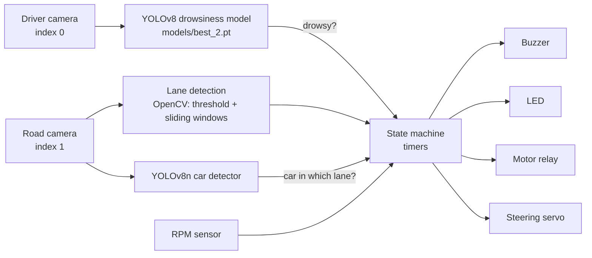

# Driver Drowsiness Detection & Assisted Pull-Over

A prototype driver-assistance system built around **YOLOv8**. A driver-facing camera classifies the driver as
*awake* or *drowsy*; when drowsiness is detected the system escalates through a **buzzer → LED → motor cut-off**
sequence and, using a second (road-facing) camera, checks lane and nearby cars before steering toward the
side of the road. Hardware control (Raspberry Pi GPIO) is optional — without a Pi, the app runs and simulates
the outputs on screen.

> ⚠️ **Educational prototype for a small-scale model vehicle.** It has not been validated for real vehicles and
> must not be used to control one. See [Limitations](#limitations).

## How it works



Alert sequence once the driver is classified **drowsy** (timings from `src/driver_assist.py`):

| Time | Action |
|------|--------|
| 0 s | Buzzer on (continuous) · lane + car detection starts (lane/car state is then fresh by the time steering is considered) |
| > 3 s | LED on |
| LED + 2 s | Servo moves from 90° to 100° (a "small turn to the right" per the code comment) for 2 s — **only if lane lines were found and no car is detected in the right outer lane** (checked every frame, so a turn is aborted if a car appears) — then returns to centre with a 3 s cool-down |
| LED + 3 s | Motor relay off |
| Driver awake again | Buzzer, LED and steering reset; motor relay back on |
| Program exits or crashes, Ctrl-C, SIGTERM | **Safe state:** buzzer and LED off, steering centred, motor relay **off** (see [Fail-safe](#fail-safe)) |

The wheel RPM sensor (300 mm wheel) feeds an on-screen RPM / speed read-out and a short 50 ms beep per pulse.

### Hardware (Raspberry Pi, BCM numbering — edit the constants at the top of `src/driver_assist.py`)

| Function | GPIO | Notes |
|----------|------|-------|
| Buzzer | 17 | via transistor/relay |
| LED | 27 | |
| Motor relay | 22 | **active-HIGH** by default (HIGH = motor on); set `MOTOR_ACTIVE_HIGH = False` for active-LOW relay modules |
| Steering servo (PWM, 50 Hz) | 18 | duty = angle/18 + 2.5 |
| RPM sensor | 26 | Autonics PR18-8DN (NPN-NO), internal pull-up, falling edge, 20 ms debounce |

Two USB cameras: by default **index 0 = driver-facing, index 1 = road-facing** (`--driver-cam` / `--road-cam` to change).

#### Fail-safe

On *any* exit path — normal quit, uncaught exception, Ctrl-C, `SIGTERM`, or a missing camera/model at start-up — an `atexit` hook puts every output in a safe state: buzzer and LED off, steering centred, **motor relay off**. The motor pin is intentionally left driven (not passed to `GPIO.cleanup()`) so the relay stays off after the process ends. This cannot help if the process is killed with `SIGKILL`, the Pi loses power or the OS hangs — for that, wire the relay so the motor is off when it is de-energised and consider a hardware watchdog.

### Model

`models/best_2.pt` — fine-tuned YOLOv8 weights (6 MB), classes `awake` / `drowsy`. The class ids are **read from the model at start-up**, so a model with the opposite order works too (a model without both classes is rejected). It is the checkpoint
saved by run **`train5`** below. A stock `yolov8n.pt` is used for car detection (Ultralytics downloads it on first run).

## Quick start

```bash
python -m venv .venv && source .venv/bin/activate      # Windows: .venv\Scripts\activate
pip install -r requirements.txt
python src/driver_assist.py                            # press q to quit
python src/driver_assist.py --driver-cam 2 --road-cam 3 --model path/to/other.pt
```

On a Raspberry Pi, `requirements.txt` also installs `RPi.GPIO`; you may need `sudo` for GPIO access.
Quick webcam-only check of the model: `python experiments/webcam_demo.py`.

**Before using a new camera mount, calibrate it** — see [`docs/calibration.md`](docs/calibration.md) and `tools/calibrate_road.py`.

### Tests

```bash
pip install numpy opencv-python-headless      # nothing else needed: no Pi, camera, GPU or ultralytics
python -m unittest discover -s tests -v       # 40 tests, ~45 s
```

They run the real application loop against fake cameras, models, clock and an `RPi.GPIO` fake that enforces the real library's rules, and cover each of the fixes listed below (for the main ones — flag order, class ids, exit hook, lane-pixel guard, servo setup, curvature units, quit key — I re-introduced the bug and confirmed the test fails). CI runs them on every push.

## Repository layout

```
src/driver_assist.py          main application (two cameras + GPIO)
models/best_2.pt              drowsiness detector
tests/                        unit + end-to-end tests (fake hardware), run in CI
tools/calibrate_road.py       check the road-camera region / bird's-eye view
docs/calibration.md           how to calibrate the road camera and distance estimate
results/                      training curves, confusion matrices and configs for 7 runs (no weights, no images)
data/                         dataset cards + licences (images not included — see data/README.md)
notebooks/lane_segmentation_fcn.ipynb   VGG16 FCN lane-segmentation experiment on KITTI Road (not used by the app)
experiments/                  webcam / drowsiness-flag demo scripts
```

## Training results

Seven YOLOv8 runs (curves in [`results/`](results)). Numbers are from each run's **own validation split**;
the runs use different datasets, so they are **not comparable with each other**, and there is no
in-vehicle or held-out real-world evaluation in this repo.

| Run | Start weights | Dataset (`data:`) | Epochs | Precision | Recall | mAP50 | mAP50-95 |
|---|---|---|---|---|---|---|---|
| train | `yolov8n.pt` | `drowsinessyolov8-1/data.yaml` | 100 | 0.992 | 0.995 | 0.995 | 0.785 |
| train2 | `best1.pt` | `data.yaml` | 100 | 0.901 | 0.913 | 0.935 | 0.645 |
| train3 | `best3.pt` | `facial-fatigue-1/data.yaml` | 100 | 0.961 | 0.973 | 0.987 | 0.696 |
| train4 | `yolov8n.pt` | `drowsinessyolov8-2/data.yaml` | 100 | 0.999 | 0.995 | 0.995 | 0.781 |
| train5 | `best_1.pt` | `data.yaml` | 100 | 0.910 | 0.922 | 0.923 | 0.620 |
| train6 | `best_2.pt` | `facial-fatigue-1/data.yaml` | 100 | 0.982 | 0.994 | 0.984 | 0.677 |
| train7 | `yolov8m-oiv7.pt` | `drowsinessyolov8-2/data.yaml` | 9 | 0.974 | 0.960 | 0.988 | 0.687 |

`train2` / `train5` record only `data.yaml` (relative), so their dataset is unknown. `train7` stopped after 9 epochs.
The shipped model comes from `train5`.

## Datasets

Third-party Roboflow datasets, **CC BY 4.0** — attribution, links and class orders are in
[`data/README.md`](data/README.md). Images are not redistributed.

## What changed from the original archive

Everything below was found by reading and running the code. Bugs are listed with how each was verified.

### Bugs fixed

| # | Problem | Fix |
|---|---------|-----|
| 1 | `habib2.py` could not run: `global wheel_speed_mps` at module level is a **`SyntaxError`** in Python 3. | Removed the line. |
| 2 | **All GPIO control silently disabled:** `GPIO.PWM()` was called before `GPIO.setup()` on the servo pin; `RPi.GPIO` raised, the script caught it and fell back to "simulated hardware". | Added `GPIO.setup(SERVO_PWM_PIN, GPIO.OUT)`. |
| 3 | **"Don't steer toward a car in the right lane" never worked.** The `car_in_*_lane` flags were reset at the top of each frame, the steering logic read them (always `False`), and they were only set later in the same frame. A test with a car placed in the right lane still turned the servo right. | Flags are reset *after* the steering decision, so it uses the previous frame's result (and aborts a turn in progress if a car appears). |
| 4 | **Class ids hard-coded** (`awake = 0`, `drowsy = 1`) although datasets disagree (`facial-fatigue-1` is the reverse) — a model with the other order would raise alerts for an *awake* driver. | Ids are read from `model.names`; models missing either class are rejected. |
| 5 | **No fail-safe:** a crash left the motor relay in its last state. | `atexit` + `SIGTERM` hook drives all outputs to a safe state (see [Fail-safe](#fail-safe)); camera/model start-up failures use it too. |
| 6 | **Lane detection crashed** on frames with no lane pixels (`np.polyfit` on empty arrays), which would have taken the whole loop down mid-drive. | Returns "lane lines not found"; the app then **refuses to steer blind** but still alarms and cuts the motor. |
| 7 | **"Radius of Curvature … m" was in pixels.** | Converted to metres from `LANE_LENGTH_M` and the lane width measured each frame (`LANE_WIDTH_M`); verified against a known radius. Shown as approximate until you calibrate. |
| 8 | Relay polarity was hard-coded in three places, and the relay started *on* with an active-LOW module. | `MOTOR_ACTIVE_HIGH` constant + `set_motor()`; the relay now starts off. |
| 9 | Notebook: `list_files()` **reshuffled every epoch**, moving images between train/validation/test; fixed 2000/400 split can't work on KITTI Road (~290 images); `clear_output` never imported (crash after epoch 1); undefined `true_mask`; `callbacks` list shadowed the Keras module; `decode_jpeg` used for PNG files. | One deterministic 70/15/15 split from the files found, imports and names fixed, `decode_image`. |
| 10 | `experiments/*.py`: no `stream=True` (all frames buffered in memory), `destroyAllWindows()` inside the loop, `q` ignored unless a face was detected, hard-coded class ids. | Rewritten as small scripts with `--source`/`--model`, tested. |

### Added

`tests/` (40 tests, CI), `tools/calibrate_road.py`, `docs/calibration.md`, CLI options (`--driver-cam`, `--road-cam`, `--model`), and a **Configuration** block at the top of `src/driver_assist.py` (relay polarity, road region, lane/length metres, distance calibration, minimum lane pixels).

### Repository clean-up

Layout, requirements, `.gitignore`, local `C:\Users\…` paths removed from the notebook/YAML files, notebook outputs cleared, and the heavy or personal material below left out.

Deliberately **left out**: the ~237 MB of dataset images, 440 MB of `.avi` prediction videos, the other 14 `.pt` weight files (one is a duplicate of `best_2.pt`), a 34 MB demo video (`Timeline 1.mp4` — better as a GitHub Release or link), and the sample/prediction photos, which appear to show an identifiable person's face (at least one clearly does) — add them back only if you have their consent.

## Limitations

- **Not validated on real hardware.** Everything above was tested against fakes. It has not been run on a Raspberry Pi with real cameras, a relay, servo or motor, and `notebooks/lane_segmentation_fcn.ipynb` was edited and syntax-checked but not executed (no TensorFlow or dataset here).
- **Calibration is per camera mount.** The defaults in `ROAD_ROI`, `LANE_WIDTH_M`, `LANE_LENGTH_M` and `FOCAL_LENGTH_PIXELS` are placeholders from the original build — follow [`docs/calibration.md`](docs/calibration.md). Lane lines are found with colour/gradient thresholds, so poor contrast, glare or night driving will give "Lane lines not found" (and no steering).
- **The detector's real-world accuracy is unknown.** The datasets are small (552–3,203 images each) and the reported metrics come from each run's own validation split. There is no held-out, in-vehicle or per-person/lighting evaluation in this repo; collecting one is data work, not something code can fix.
- **Software fail-safe only.** It cannot act on `SIGKILL`, power loss or an OS hang — see [Fail-safe](#fail-safe).
- **Educational prototype for a small-scale model vehicle,** not for real vehicles.

## Licensing

No `LICENSE` file is included — choose one that suits you. Note that **Ultralytics YOLO is AGPL-3.0** (or commercial)
and the **datasets are CC BY 4.0** (attribution required).
